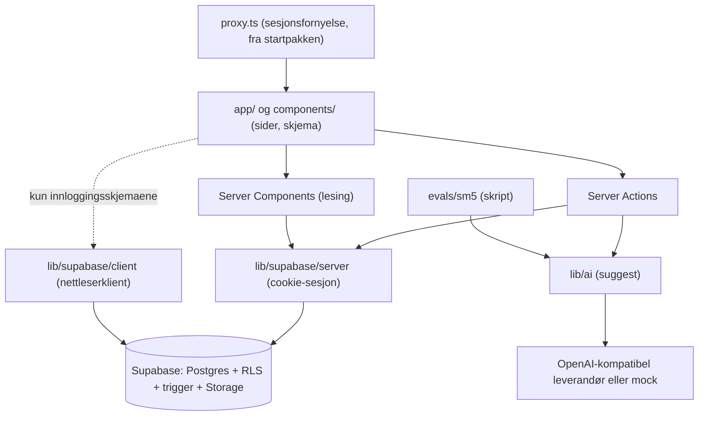
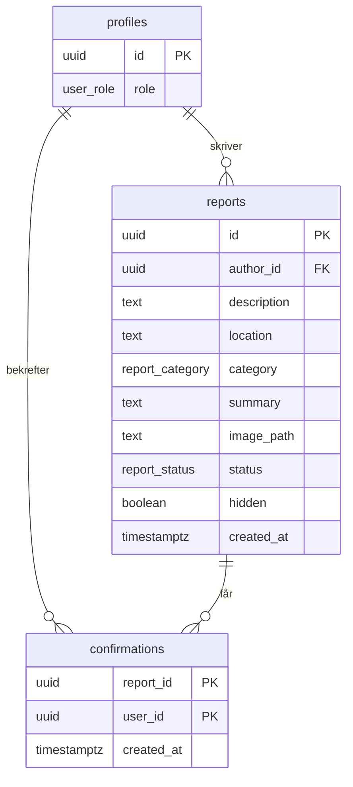
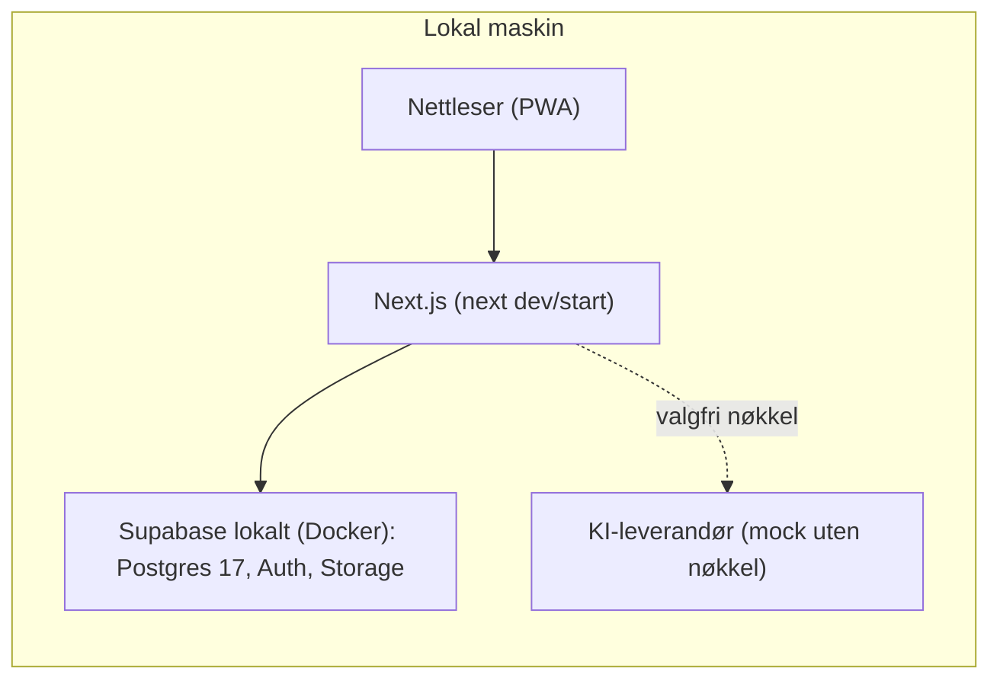

# Architecture Spine: LocalFix

## Design Paradigm

**Databasestyrt, servergjengitt monolitt.** Alle domeneregler bor i Postgres (RLS, kolonnegrants, triggere, visninger). Next.js App Router er et tynt lag som gjengir sider og videresender brukerens egen sesjon. Koden er én kodebase, og KI-kallet ligger bak ett grensesnitt.

| Lag | Mappe | Ansvar |
| --- | --- | --- |
| Presentasjon | `app/`, `components/` | Sider, skjema, shadcn/ui. Ingen regler, ingen datatilgang |
| Handling | `app/**/actions.ts` | Server Actions: validerer input, kaller databasen med brukerens sesjon, oversetter feil |
| Tilgang | `lib/supabase/` | Eneste sted en Supabase-klient opprettes |
| KI | `lib/ai/` | `suggest`-grensesnitt, mock- og OpenAI-kompatibel adapter |
| Regler og data | `supabase/` | Migreringer, RLS, grants, triggere, visning, seed, databasetester |



Avhengighetsretningen er regelen: piler viser hvem som kan importere hvem. Den stiplede pilen er det eneste unntaket (AD-3). `components/` importerer ellers verken `lib/supabase/` eller `lib/ai/`.

## Invariants & Rules

### AD-1 — Databasen eier alle domeneregler `[ADOPTED]`

- **Binds:** FR-2, FR-7, FR-8, FR-9, NFR-4
- **Prevents:** Regler duplisert i TypeScript og SQL som driver fra hverandre, og omgåelse via direkte kall mot Supabase
- **Rule:** Hver rettighets- og domeneregel (rolle, én bekreftelse, statusflyt, skjuling, hvem som kan endre hva) uttrykkes i Postgres. TypeScript kan sjekke input for å gi en bedre feilmelding, men er aldri den eneste kontrollen. Tjenestenøkkelen brukes aldri til vanlige brukerhandlinger.

### AD-2 — Startpakke: `with-supabase`, versjoner låses etter oppstart `[ADOPTED]`

- **Binds:** all frontend og autentisering
- **Prevents:** Ulike innloggings- og klientmønstre, og uforutsigbare versjoner
- **Rule:** Prosjektet opprettes fra det offisielle Next.js-eksempelet `with-supabase` (App Router, `@supabase/ssr` med cookies, shadcn/ui, Tailwind, `proxy.ts` for sesjonsfornyelse). Startpakken har ingen låsefil og bruker `latest`, så låsefil opprettes og committes ved første installasjon, og versjonene i Stack-tabellen oppdateres til de som ble låst. Startpakkens Tailwind (3.4.x) beholdes i v1 og oppgraderes ikke. Mønsteret for sesjon og klientoppretting fra startpakken utvides ikke med et annet.

### AD-3 — All dataflyt via serveren, ett navngitt unntak for innlogging `[ADOPTED]`

- **Binds:** FR-1 til FR-9
- **Prevents:** Blandede mønstre for datatilgang, klientside datatilgang som glemmer innloggingstilstand
- **Rule:** Sider leser i Server Components. Skriving skjer i Server Actions. Supabase-klienten opprettes per forespørsel fra brukerens cookie (`lib/supabase/server`). Nettleseren kaller ikke Supabase for data. Det finnes ingen egne REST-ruter for domenelogikk. **Unntak:** nettleserklienten (`lib/supabase/client`) brukes bare i innloggingsskjemaene (`signIn`, `signUp`, `signOut`) og aldri til data. Retur-adressen etter innlogging må starte med `/` og ikke `//`. Moderatorreglene testes direkte mot Supabases REST-grense uavhengig av appen (se Tester).

### AD-4 — Kjernemodell: tre tabeller `[ADOPTED]`

- **Binds:** FR-1, FR-3, FR-5, FR-6, FR-7, FR-8, FR-9
- **Prevents:** To tolkninger av entitetene, verdisettene og tomme verdier
- **Rule:** Tabellene er `profiles`, `reports` og `confirmations` med feltene i ERD-et. `role`, `category` og `status` er Postgres-enum, og rekkefølgen `new, in_progress, resolved` er en del av kontrakten. Alle kolonner er `NOT NULL` unntatt `reports.summary` og `reports.image_path`, som lagrer `NULL` og aldri tom streng. `description` og `location` har `CHECK (length(btrim(x)) > 0)`. Lengdegrensene er `description` 1000, `location` 200 og `summary` 300 tegn, og de samme tallene brukes i skjemaene fra `lib/limits.ts`. Alle fremmednøkler er `ON DELETE RESTRICT`. `confirmations` har sammensatt primærnøkkel `(report_id, user_id)`. Profilraden opprettes bare av triggerfunksjonen `handle_new_user` på `auth.users`, som er den eneste `security definer`-funksjonen i systemet: den har `SET search_path = ''`, kan ikke kjøres av `anon` eller `authenticated`, setter `role = 'user'` hardkodet og leser aldri `raw_user_meta_data` eller `raw_app_meta_data`. Ingen Server Action oppretter eller endrer `profiles`. Det finnes ingen sletting av rapporter (FR-9).

### AD-5 — Antall bekreftelser kommer fra én visning `[ADOPTED]`

- **Binds:** FR-5, FR-6, FR-7
- **Prevents:** En teller som driver ut av synk, rapporter som forsvinner fra lista, og to ulike kolonnenavn
- **Rule:** Visningen heter `reports_with_counts`, har `security_invoker = true` og er `FROM reports LEFT JOIN confirmations`. Den returnerer alle kolonnene i `reports` pluss `confirmation_count integer NOT NULL` (`count(c.user_id)::int`, aldri `NULL`) og `confirmed_by_me boolean NOT NULL` (`false` for anonyme). Lista og detaljsiden leser bare fra visningen, og skriving går alltid mot `reports`. SELECT på `confirmations` er tillatt for `anon` og `authenticated` når den tilhørende rapporten er synlig under RLS. Appen leser aldri `confirmations` direkte og viser aldri hvem som har bekreftet, bare antallet og brukerens egen bekreftelse.

### AD-6 — Skjulte rapporter og bilder følger samme regel `[PROVISIONAL]`

- **Binds:** FR-5, FR-9, NFR-4
- **Prevents:** At en skjult rapport lekker via bilde-URL, og at en synlig rapport peker på en annens bilde
- **Rule:** `reports.hidden` styrer synlighet. Lesing er tillatt når `hidden = false` eller brukeren er moderator (AD-14). Storage-policyen for `report-images` slår opp rapporten via `image_path` og kjører under innsetterens RLS, så den gir bare lesetilgang til bilder som hører til synlige rapporter. `reports` har `CHECK (image_path IS NULL OR image_path LIKE author_id::text || '/%')` og `UNIQUE (image_path)`. Appen filtrerer aldri på `hidden` selv: RLS alene avgjør hva som vises. **Foreløpig** fordi Storage-oppslaget ikke er bekreftet i dokumentasjonen. Reserve hvis en pgTAP-test viser at det ikke virker: en liten, server-eid modul signerer lenker etter at rapporten er lest med brukerens sesjon. Det krever en eksplisitt endring av AD-11 og skal avgjøres av prosjekteieren.

### AD-7 — Statusflyt, skjuling og bekreftelser med RLS, grants og trigger `[ADOPTED]`

- **Binds:** FR-2, FR-7, FR-8, FR-9, NFR-4
- **Prevents:** Hopp i statusflyt, endring av andre felt, forfalskede bekreftelser, og 0-rader-oppdateringer som ser ut som suksess
- **Rule:**
  - **Oppdatering av `reports`:** RLS-policyen har `USING` for synlige rader og `WITH CHECK (private.is_moderator())`. Triggeren `reports_guard_update` kjører først og kaster SQLSTATE `42501` for ikke-moderatorer, så FR-2 gir 403 og ikke en stille 0-rader-oppdatering. Deretter krever den at alt unntatt `status` og `hidden` er uendret, sjekket som `(to_jsonb(NEW) - 'status' - 'hidden') IS NOT DISTINCT FROM (to_jsonb(OLD) - 'status' - 'hidden')`, ellers feilen `invalid_column_change`. Er `status` uendret er oppdateringen lov (skjuling og tom oppdatering er idempotente). Er `status` endret må forskjellen i enum-rekkefølge være nøyaktig 1, ellers `invalid_status_step`. `status` og `hidden` kan endres i samme oppdatering og på skjulte rapporter.
  - **Feilkoder:** Triggeren kaster `RAISE EXCEPTION USING ERRCODE = 'P0001', MESSAGE = '<kode>'`, og `lib/errors.ts` slår opp på `MESSAGE`.
  - **Bekreftelser:** INSERT krever `user_id = auth.uid()` og `EXISTS (SELECT 1 FROM reports r WHERE r.id = report_id AND r.hidden = false AND r.author_id <> auth.uid())`. Det brukes aldri `NOT EXISTS` på `author_id`. Moderator kan bekrefte andres rapporter som en bruker, og rapportens status spiller ingen rolle. Det finnes ingen UPDATE- eller DELETE-policy eller -grant på `confirmations`.
  - **Server Actions** sjekker alltid både `error` og antall rader som kommer tilbake.

### AD-8 — KI bak ett grensesnitt med to adaptere `[ADOPTED]`

- **Binds:** FR-4, SM-5, SM-6, NFR-2, NFR-3, NFR-7
- **Prevents:** At appen og SM-5-testen kaller KI-en ulikt, leverandørlås, og at KI-svar behandles som tillitsverdig tekst
- **Rule:** `suggest(description)` returnerer `{ category, summary }` eller `null`. Adaptere: mock og OpenAI-kompatibel (base-URL, modell og nøkkel fra miljøvariabler). Appen og SM-5-skriptet kaller samme modul. Kallet skjer bare i en Server Action, bare for innloggede brukere, med høyst 2000 tegn av beskrivelsen og ett kall om gangen per bruker. Svaret valideres mot kategorienes kodeverdier. Sammendraget er ren tekst, kortes til 300 tegn og vises aldri som HTML. Timeout (5 sekunder), ugyldig svar eller feil gir `null`, og skjemaet fortsetter med manuelt valg. Mock er standard når nøkkel mangler og gir forutsigbare svar etter nøkkelord. SM-5-skriptet melder at resultatet ikke gjelder kvalitet når det kjører mot mock.

### AD-9 — Bildeopplasting via serveren `[PROVISIONAL]`

- **Binds:** FR-3, FR-9, NFR-4
- **Prevents:** To opplastingsveier, bilder som lekker utenom AD-6, og løse eller overskrevne filer
- **Rule:** En Server Action tar imot filen, validerer type (JPEG, PNG, WebP) og størrelse (5 MB) og laster den opp til den private bucketen `report-images` med brukerens sesjon. Stien er `<author_id>/<uuid>.<ext>` med alltid en ny uuid, og lagres i `reports.image_path`. Policyene på `storage.objects` for denne bucketen er uttømmende: INSERT for `authenticated` bare når `(storage.foldername(name))[1] = auth.uid()::text`; SELECT som i AD-6 for `anon` og `authenticated`; ingen UPDATE og ingen `upsert`; DELETE bare for eieren og bare når ingen rad i `reports` har denne `image_path`. Bucketen har egne grenser for størrelse og type som ekstra sikring, og serverens grense for forespørselsstørrelse settes høyt nok for 5 MB pluss overhead. Bilder vises via signerte lenker som lages på serveren, varer 60 sekunder og hentes i én batch per side (`createSignedUrls`). En moderator som skjuler en rapport aksepterer at allerede utstedte lenker lever til de utløper. Bildet lastes opp først og slettes hvis opprettelsen av rapporten feiler. Skjemaet har en engangsnøkkel som hindrer dobbel innsending. **Foreløpig** fordi rettigheten `createSignedUrl` krever, og tilfellet med anonyme besøkende, ikke er bekreftet.

### AD-10 — Kodeverdier i enum, én labels-fil og genererte typer

- **Binds:** FR-3, FR-4, FR-6, FR-8
- **Prevents:** Norske tegn i enum-verdier, og at KI-en, filtrene og skjemaet bruker ulike navn eller kilder for samme kategori
- **Rule:** Kategorier er `waste`, `lighting`, `roads_sidewalks`, `vandalism`, `other`. Statuser er `new`, `in_progress`, `resolved`. Rolle er `user`, `moderator`. TypeScript-typene genereres fra databasen (`supabase gen types`) til `lib/supabase/database.types.ts` og er eneste kilde til kodeverdiene. Norske visningsnavn («Søppel», «Under behandling») hentes fra én fil, `lib/labels.ts`, nøklet på de genererte typene. KI-en svarer med kodeverdiene.

### AD-11 — Kjørbar lokalt uten nøkler `[ADOPTED]`

- **Binds:** NFR-2, NFR-3, NFR-7, SM-7
- **Prevents:** At appen krever hemmeligheter, skytjenester eller tjenestenøkkelen for å starte, og at oppsettet driver mellom maskiner
- **Rule:** Appen startes med Supabase CLI og Docker. `supabase/seed.sql` oppretter en moderatorkonto, brukerkontoer og rapporter i alle kategorier og statuser, og kjører som `postgres`, så ingen trigger eller policy avhenger av at seed er blokkert. Testbilder seedes via `[storage.buckets.report-images]` med `objects_path` i `config.toml`. Tjenestenøkkelen brukes bare i seed og migrering og leses aldri av appen. Alle miljøvariabler valideres i `lib/env.ts` og står i `.env.example`. `.env` er i `.gitignore`. Uten KI-nøkkel går appen i mock-modus. Registrering krever ikke e-postbekreftelse lokalt (`enable_confirmations = false`). `supabase/config.toml` endres bare i en egen endring. Docker Desktop er en forutsetning og står først i README.

### AD-12 — Skriverettigheter per tabell er uttømmende

- **Binds:** FR-2, FR-3, FR-7, FR-8, FR-9, NFR-4
- **Prevents:** Forfalskede felt ved INSERT, og to tolkninger av hvem som kan skrive hva
- **Rule:** Rettighetene er en eksplisitt matrise, og alt som ikke står der er forbudt. RLS er slått på for alle tabeller i `public`, og policyene navngir alltid rolle (`TO anon`, `TO authenticated`), aldri bare `public`.

| Tabell | anon | authenticated | moderator (i tillegg) |
| --- | --- | --- | --- |
| `profiles` | ingen | SELECT egen rad | ingen |
| `reports` | SELECT synlige | SELECT synlige. INSERT kolonnene `description, location, category, summary, image_path` | SELECT alle. UPDATE kolonnene `status, hidden` |
| `confirmations` | SELECT (AD-5) | SELECT (AD-5). INSERT (AD-7) | ingen |
| `storage.objects` (`report-images`) | SELECT (AD-6) | SELECT (AD-6). INSERT og DELETE (AD-9) | SELECT alle |

  INSERT på `reports` gis som kolonnegrant, ikke bredt. `author_id` har `DEFAULT auth.uid()`, `status` har `DEFAULT 'new'`, `hidden` har `DEFAULT false` og `created_at` har `DEFAULT now()`, og ingen av dem kan settes av `authenticated`. INSERT-policyen har `WITH CHECK (author_id = auth.uid())`. Ingen tabell i `public` har DELETE- eller TRUNCATE-grant. Rolle settes bare med SQL som `postgres` (seed og README).

### AD-13 — Ingen mellomlagring av brukeravhengige data

- **Binds:** FR-5, FR-8, FR-9, NFR-4
- **Prevents:** At en moderators visning av skjulte rapporter eller en signert bildelenke serveres til andre, og at statusendringer ikke vises
- **Rule:** Sider som leser `reports_with_counts` eller lager signerte lenker er dynamiske (`export const dynamic = 'force-dynamic'`). Ingen funksjon som leser fra Supabase bruker `'use cache'`, `unstable_cache` eller `fetch`-cache. Rapportbilder vises med `` eller `next/image` med `unoptimized`, aldri gjennom bildeoptimereren. Responser med signerte lenker sendes med `Cache-Control: private, no-store`. Hver Server Action som endrer `reports` eller `confirmations` kaller `revalidatePath` for lista og detaljsiden.

### AD-14 — Én definisjon av moderator og lukkede standarder

- **Binds:** FR-2, NFR-4
- **Prevents:** Rolle lest fra brukerstyrte kilder, rekursive policyer, åpne tabeller og funksjoner
- **Rule:** Moderator betyr `EXISTS (SELECT 1 FROM public.profiles WHERE id = auth.uid() AND role = 'moderator')`, uttrykt i funksjonen `private.is_moderator()` (`STABLE`, `SECURITY INVOKER`) som alle policyer og triggere bruker. `profiles` har bare policyen «SELECT egen rad», så funksjonen er ikke rekursiv. Rollen leses aldri fra JWT, `user_metadata` eller `app_metadata`. Hjelpefunksjoner ligger i skjemaet `private`, som PostgREST ikke eksponerer. Hver migrering som oppretter en tabell i `public` slår på RLS i samme migrering og tilbakekaller standardgrants (`REVOKE ALL ... FROM anon, authenticated`) før nødvendige grants gis. En pgTAP-test feiler hvis en tabell i `public` mangler RLS, og hvis `anon` eller `authenticated` kan kjøre en funksjon i `public` som ikke står på en tillatelsesliste.

## Consistency Conventions

| Concern | Convention |
| --- | --- |
| Navn | Engelsk `snake_case` i database, engelske navn i kode. UI-tekst er norsk bokmål uten flerspråkstøtte i v1 |
| Data og formater | `uuid` som id. `timestamptz` i UTC, vist i `Europe/Oslo`. Valgfrie felt er `NULL`, aldri tom streng. Visning bruker `summary ?? description` |
| Server Actions | Svarer `{ ok: true, data }` eller `{ ok: false, error: { code, message } }`. Moderatorhandlinger er `setReportStatus(reportId, from, to)` og `setReportHidden(reportId, hidden)` med eksplisitt målverdi, aldri toggle. `setReportStatus` oppdaterer med `WHERE id = $1 AND status = $2` og gir `stale_state` hvis ingen rad ble endret. `confirmReport(reportId)` gir `already_confirmed` ved SQLSTATE `23505` |
| Feilkoder | Lukket vokabular: `unauthenticated, forbidden, invalid_status_step, invalid_column_change, already_confirmed, own_report, report_not_found, stale_state, validation_failed, upload_failed, ai_unavailable, unknown`. `lib/errors.ts` slår opp på `MESSAGE` for egne feil og på SQLSTATE `23505` og `42501` for de innebygde. Databasetekst lekkes aldri til brukeren |
| Filter og sortering | URL-parametrene er `category`, `status` (enum-koder) og `sort` (`newest` er standard, `confirmations`). Ukjente verdier ignoreres. Sortering er `confirmation_count DESC, created_at DESC, id DESC` eller `created_at DESC, id DESC`. Moderator ser skjulte rapporter blandet inn med merket «Skjult» |
| Detaljside | En rapport som ikke finnes eller ikke er synlig gir `notFound()` (404) i begge tilfeller |
| Konfigurasjon | Kun via `lib/env.ts`, aldri `process.env` direkte i andre filer |
| Logging | Bare `console`, aldri rapporttekst eller e-postadresser |
| Tester | Databaseregler: pgTAP med `supabase test db`, med hjelperne `tests.as_user(uuid)` og `tests.as_anon()` som setter rolle og JWT-claims, ellers blir `auth.uid()` `NULL` og testene består uten å teste noe. REST-grensen testes av et lite Vitest-skript mot lokal PostgREST for 401 og 403 (FR-2, FR-7). Ren logikk: Vitest. SM-5: eget skript i `evals/sm5/` |
| PWA | `app/manifest` gir installerbarhet (NFR-5). Ingen service worker eller frakoblet modus i v1 |

## Stack

Versjonene er bekreftet mot npm 2026-10-28. Startpakken har ingen låsefil, så tabellen oppdateres til de låste versjonene ved første installasjon (AD-2).

| Name | Version |
| --- | --- |
| Next.js | 16.4.3 |
| React | 19.3.1 |
| `@supabase/supabase-js` | 2.118.0 |
| `@supabase/ssr` | 0.12.7 |
| Supabase CLI | 2.122.0 |
| PostgreSQL (lokal Supabase) | 17 |
| Tailwind CSS | 3.4.x (følger startpakken) |
| shadcn (CLI) | 4.23.0 |
| Zod | 4.6.7 |
| Vitest | 5.0.5 |
| Node.js (utvikling) | 24.19.0 |
| Docker Desktop | påkrevd, ikke installert ennå |

## Structural Seed



`profiles.id` er lik `auth.users.id`. `summary` og `image_path` er de eneste kolonnene som kan være `NULL`. Appen leser lister og detaljer fra visningen `reports_with_counts` (AD-5).



Det finnes ett miljø i v1: lokalt. Det er ingen hostet utgave, ingen produksjonsdatabase og ingen CI.

```text
localfix/
  app/                  # App Router: sider, layout, Server Actions (actions.ts per rute), manifest
  components/           # shadcn/ui og egne komponenter, ingen datatilgang
  lib/
    supabase/           # server (cookie-sesjon), client (kun innlogging), database.types.ts
    ai/                 # suggest-grensesnitt, mock- og OpenAI-kompatibel adapter, validering
    labels.ts           # norske visningsnavn for enum-verdier
    limits.ts           # lengdegrenser delt mellom skjema og database
    env.ts              # validerte miljøvariabler
    errors.ts           # oversetter databasefeilkoder
  proxy.ts              # sesjonsfornyelse (fra startpakken)
  supabase/
    config.toml
    migrations/         # skjema, enum, grants, RLS, triggere, visning, storage-policy
    seed.sql            # moderator@localfix.test, brukere, rapporter i alle kategorier og statuser
    seed-images/        # testbilder, lastet inn via objects_path
    tests/              # pgTAP og hjelperne tests.as_user / tests.as_anon
  evals/sm5/            # 20 beskrivelser med fasit og skript som bruker lib/ai
  .env.example
  README.md
```

## Capability → Architecture Map

| Capability / Area | Lives in | Governed by |
| --- | --- | --- |
| FR-1 Registrering og innlogging | `app/` (innlogging), `lib/supabase/`, `proxy.ts`, `handle_new_user` | AD-2, AD-3, AD-4, AD-12 |
| FR-2 Moderatorrolle | `supabase/migrations` (RLS, trigger, `private.is_moderator`) | AD-1, AD-7, AD-12, AD-14 |
| FR-3 Registrere rapport | skjema og Server Action | AD-3, AD-4, AD-9, AD-10, AD-12 |
| FR-4 KI-forslag | `lib/ai/`, Server Action | AD-8, AD-10 |
| FR-5 Liste og detalj | Server Components, `reports_with_counts` | AD-3, AD-5, AD-6, AD-13 |
| FR-6 Filter og sortering | URL-parametre, databasespørring | AD-5, AD-10, konvensjon |
| FR-7 Bekrefte | Server Action, `confirmations` | AD-1, AD-5, AD-7, AD-12 |
| FR-8 Endre status | Server Action, trigger | AD-1, AD-7, AD-13 |
| FR-9 Skjule og vise | Server Action, RLS, Storage-policy | AD-1, AD-6, AD-7, AD-13 |
| NFR-1 Responsivitet | `components/`, Tailwind, shadcn/ui | UX (DESIGN.md, EXPERIENCE.md) |
| NFR-2, NFR-3 Kjørbar lokalt, ingen nøkler | `supabase/`, `lib/env.ts`, README | AD-11 |
| NFR-4 Tilgangskontroll | `supabase/migrations` | AD-1, AD-7, AD-12, AD-14 |
| NFR-5 PWA | `app/manifest` | Konvensjon |
| NFR-6 Ytelse (100 rapporter under 2 s) | `reports_with_counts`, `createSignedUrls` | AD-5, AD-9 |
| NFR-7 Kostnad | Ingen betalte tjenester | AD-8, AD-11 |
| SM-1 til SM-4 | pgTAP, Vitest, seed | AD-7, AD-12, konvensjon (Tester) |
| SM-5, SM-6 KI-testsett og fallback | `evals/sm5/`, `lib/ai/` | AD-8 |
| SM-7 Start etter README | README, seed, Docker | AD-11 |

## Deferred

| Utsatt | Hvorfor det kan vente | Revisit |
| --- | --- | --- |
| Endelig KI-leverandør (foreløpig Cloudflare Workers AI, Gemma 4 26B A4B; nest beste Groq) | Avgjøres av SM-5-testen bak AD-8 | Når SM-5 er kjørt |
| Verifisering av Storage-oppslaget i AD-6, rettigheten `createSignedUrl` krever, og tilfellet med anonyme besøkende (AD-6, AD-9) | Ikke bekreftet i dokumentasjonen | Ved første bygg, med en pgTAP-test per utnyttelse. AD-6 og AD-9 står som foreløpige til da |
| Kompatibilitet mellom shadcn CLI 4.x og startpakkens Tailwind 3.4, og mellom Vitest 5 og Next.js | Ikke sjekket | Ved oppstart |
| Hosting av Next.js og Supabase, HTTPS, CI | Ikke et krav i v1, har egne personvern-, region- og kostnadsspørsmål. Installerbarhet (NFR-5) testes på localhost | Hvis en offentlig demo ønskes |
| Ende-til-ende-tester | Databasetester og Vitest dekker reglene | Etter at kjerneflyten virker |
| Paginering, varsler, sanntid, kart, frakoblet modus | Utenfor omfang i v1 (PRD §6.2) | Etter v1 |
| Rate limiting av KI-kallet utover innlogging, 2000 tegn og ett kall om gangen | Gratiskvoten er liten, og registrering er åpen | Hvis kvoten tømmes i praksis |
| Admin-side for moderatorer | Opprykk skjer med SQL (PRD §11) | Etter v1 |
