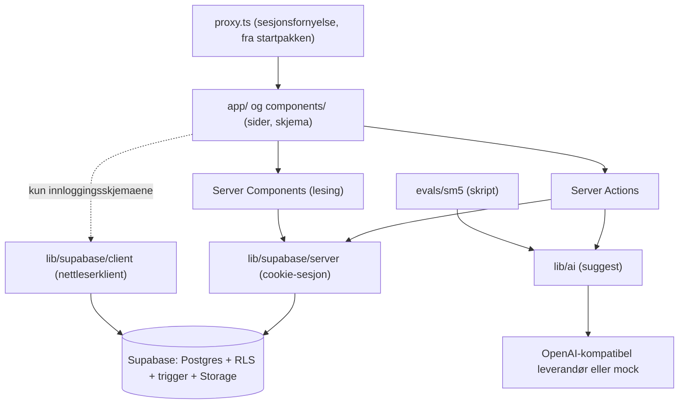
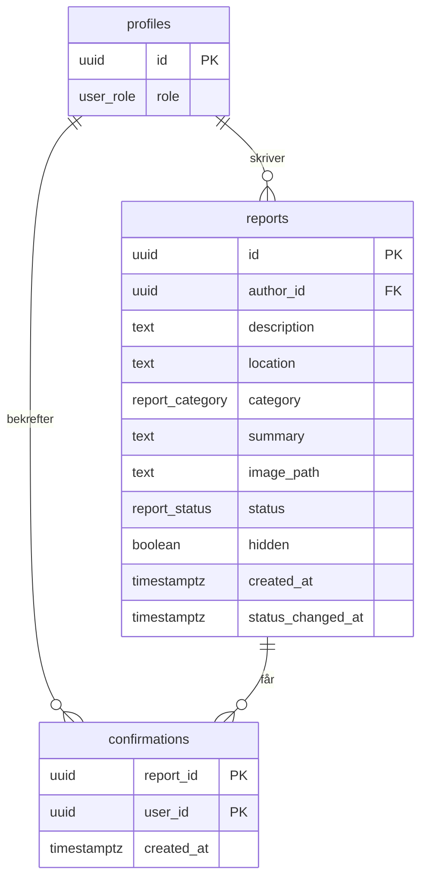
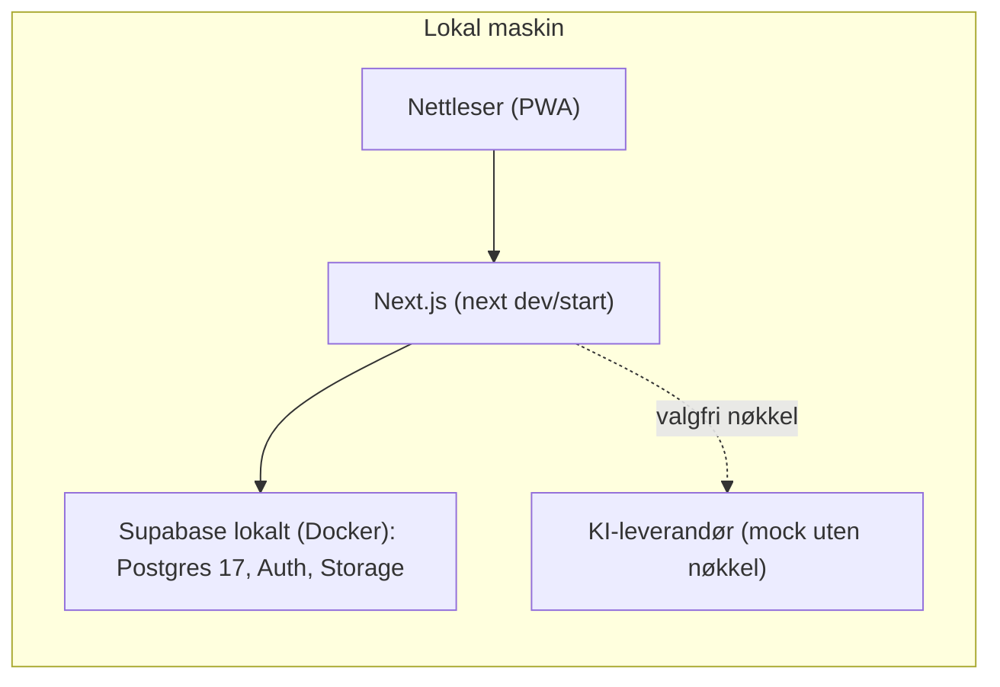

# Architecture Spine: LocalFix

## Design Paradigm

**Databasestyrt, servergjengitt monolitt.** Alle domeneregler bor i Postgres (RLS, kolonnegrants, triggere, visninger). Next.js App Router er et tynt lag som gjengir sider og videresender brukerens egen sesjon. Koden er én kodebase, og KI-kallet ligger bak ett grensesnitt.

| Lag | Mappe | Ansvar |
| --- | --- | --- |
| Presentasjon | `app/`, `components/` | Sider, skjema, shadcn/ui. Ingen regler, ingen datatilgang |
| Handling | `app/**/actions.ts` | Server Actions: validerer input, kaller databasen med brukerens sesjon, oversetter feil |
| Tilgang | `lib/supabase/` | Eneste sted en Supabase-klient opprettes |
| KI | `lib/ai/` | `suggest`-grensesnitt, mock- og OpenAI-kompatibel adapter |
| Regler og data | `supabase/` | Migreringer, RLS, grants, triggere, visning, seed, databasetester |



Avhengighetsretningen er regelen: piler viser hvem som kan importere hvem. Den stiplede pilen er det eneste unntaket (AD-3). `components/` importerer ellers verken `lib/supabase/` eller `lib/ai/`.

## Invariants & Rules

### AD-1 — Databasen eier alle domeneregler `[ADOPTED]`

- **Binds:** FR-2, FR-7, FR-8, FR-9, NFR-4
- **Prevents:** Regler duplisert i TypeScript og SQL som driver fra hverandre, og omgåelse via direkte kall mot Supabase
- **Rule:** Hver rettighets- og domeneregel (rolle, én bekreftelse, statusflyt, skjuling, hvem som kan endre hva) uttrykkes i Postgres. TypeScript kan sjekke input for å gi en bedre feilmelding, men er aldri den eneste kontrollen. Tjenestenøkkelen brukes aldri til vanlige brukerhandlinger.

### AD-2 — Startpakke: `with-supabase`, versjoner låses etter oppstart `[ADOPTED]`

- **Binds:** all frontend og autentisering
- **Prevents:** Ulike innloggings- og klientmønstre, og uforutsigbare versjoner
- **Rule:** Prosjektet opprettes fra det offisielle Next.js-eksempelet `with-supabase` (App Router, `@supabase/ssr` med cookies, shadcn/ui, Tailwind, `proxy.ts` for sesjonsfornyelse). Startpakken har ingen låsefil og bruker `latest`, så låsefil opprettes og committes ved første installasjon, og versjonene i Stack-tabellen oppdateres til de som ble låst. Startpakkens Tailwind (3.4.x) beholdes i v1 og oppgraderes ikke. Mønsteret for sesjon og klientoppretting fra startpakken utvides ikke med et annet.

### AD-3 — All dataflyt via serveren, ett navngitt unntak for innlogging `[ADOPTED]`

- **Binds:** FR-1 til FR-9
- **Prevents:** Blandede mønstre for datatilgang, klientside datatilgang som glemmer innloggingstilstand
- **Rule:** Sider leser i Server Components. Skriving skjer i Server Actions. Supabase-klienten opprettes per forespørsel fra brukerens cookie (`lib/supabase/server`). Nettleseren kaller ikke Supabase for data. Det finnes ingen egne REST-ruter for domenelogikk. **Unntak:** nettleserklienten (`lib/supabase/client`) brukes bare i innloggingsskjemaene (`signIn`, `signUp`, `signOut`) og aldri til data. `proxy.ts` fornyer bare sesjonen og sender aldri besøkende til innlogging, siden besøkende kan lese lista og detaljsidene (FR-5). Sender startpakkens proxy besøkende til innlogging, fjernes den regelen ved oppstart. `lib/supabase/auth.ts` eksporterer `getViewer()` (`{ user, isModerator }`, med brukeren fra `auth.getUser()` og rollen fra brukerens egen rad i `profiles`, aldri fra JWT) og `requireUser(returnTo)`, som sender til `/auth/login?next=<sti>`. Siden for ny rapport og hver Server Action som krever innlogging, kaller `requireUser` først. Parameteren heter `next`, og retur-adressen godtas bare når `new URL(next, origin).origin === origin`, ellers brukes `/` (å starte med `/` er ikke nok, siden `/\evil.example` peker til et annet domene). Moderatorreglene testes direkte mot Supabases REST-grense uavhengig av appen (se Tester).

### AD-4 — Kjernemodell: tre tabeller `[ADOPTED]`

- **Binds:** FR-1, FR-3, FR-5, FR-6, FR-7, FR-8, FR-9
- **Prevents:** To tolkninger av entitetene, verdisettene og tomme verdier
- **Rule:** Tabellene er `profiles`, `reports` og `confirmations` med feltene i ERD-et. `role`, `category` og `status` er Postgres-enum, og rekkefølgen `new, in_progress, resolved` er en del av kontrakten. Alle kolonner er `NOT NULL` unntatt `reports.summary` og `reports.image_path`, som lagrer `NULL` og aldri tom streng. `description` har `CHECK (description ~ '\S' AND char_length(description) <= 1000)`, `location` har det samme med 200, og `summary` har `CHECK (summary IS NULL OR (summary ~ '\S' AND char_length(summary) <= 300))`. Server Actions trimmer tekstfeltene og lagrer tom tekst som `NULL`, også et tomt KI-svar. Skjemaene bruker de samme tallene fra `lib/limits.ts`, som teller tegn med `[...s].length` slik at TypeScript og `char_length` gir samme svar. Alle fremmednøkler er `ON DELETE RESTRICT`. `confirmations` har sammensatt primærnøkkel `(report_id, user_id)`. Profilraden opprettes bare av triggerfunksjonen `handle_new_user` på `auth.users`, som er den eneste `security definer`-funksjonen i systemet: den har `SET search_path = ''`, kan ikke kjøres av `anon` eller `authenticated`, setter `role = 'user'` hardkodet og leser aldri `raw_user_meta_data` eller `raw_app_meta_data`. Ingen Server Action oppretter eller endrer `profiles`. `reports.status_changed_at` har `DEFAULT now()`, er tidspunktet for siste statusendring og vises som «sist oppdatert» (FR-8). For en rapport som aldri har fått ny status er det registreringstidspunktet. Den settes bare av triggeren i AD-7, skjuling endrer den ikke, og `CHECK (status_changed_at >= created_at)` gjelder. Det finnes ingen sletting av rapporter (FR-9).

### AD-5 — Antall bekreftelser kommer fra én visning `[ADOPTED]`

- **Binds:** FR-5, FR-6, FR-7
- **Prevents:** En teller som driver ut av synk, en flate som glemmer å telle med rapportøren, to måter å finne egne rapporter på, rapporter som forsvinner fra lista, og to ulike kolonnenavn
- **Rule:** Visningen heter `reports_with_counts`, har `security_invoker = true` og er `FROM reports LEFT JOIN confirmations`. Den returnerer alle kolonnene i `reports` pluss:
  - `confirmation_count integer NOT NULL` (`count(c.user_id)::int`, aldri `NULL`), brukt til sortering.
  - `seen_count integer NOT NULL` (`confirmation_count + 1`), som er telleren «har sett dette» (rapportøren telles med, PRD §3). Grensesnittet viser bare `seen_count` og regner aldri selv.
  - `confirmed_by_me boolean NOT NULL` (`coalesce(bool_or(c.user_id = auth.uid()), false)`). `auth.uid()` er `NULL` uten innlogging, så uttrykket uten `coalesce` ville gitt `NULL` og ikke `false`.
  - `authored_by_me boolean NOT NULL` (`coalesce(r.author_id = auth.uid(), false)`, altså `false` for anonyme). Filteret «Mine rapporter» og teksten «Din rapport» på bekreftknappen bruker bare denne kolonnen, aldri en sammenligning i TypeScript.

  En visning kan ikke ha `NOT NULL`: uttrykkene over er det som garanterer at ingen av kolonnene blir `NULL`. De genererte typene gjør dem likevel nullbare, så `lib/supabase/types.ts` overstyrer nullbarheten for disse kolonnene (`MergeDeep` fra `type-fest`), og komponentene bruker bare radtypen derfra. Bekreftknappen kan øke `seen_count` med én optimistisk, og tallet erstattes av serverens verdi etter `revalidatePath`. Visningen får `REVOKE ALL` og så `GRANT SELECT` til `anon` og `authenticated`, og lages på nytt i samme migrering som endrer `reports`. **Personvern (godtatt 2026-11-06):** `author_id` og `confirmations.user_id` er ugjennomsiktige uuid-er som alle som kan se rapporten, kan lese via REST, og mappenavnet `<author_id>/` står i hver signerte bildelenke. PRD §8 gjelder det appen viser, og avveiningen er godtatt for v1, som bare kjører lokalt med testdata og må lukkes før drift (Deferred). Appen sender aldri `author_id`, `user_id` eller `image_path` til nettleseren: Server Components velger kolonnene eksplisitt (`REPORT_COLUMNS` i `lib/supabase/types.ts`), og klientkomponentene får bare id, visningsfeltene, `seen_count`, `confirmed_by_me`, `authored_by_me`, `hidden`, om rapporten har bilde, og den signerte lenken. En Playwright-test kontrollerer at lista og dens RSC-nyttelast ikke inneholder seed-forfatterens uuid.

  Lista og detaljsiden leser bare fra visningen, og skriving går alltid mot `reports`. SELECT på `confirmations` er tillatt for `anon` og `authenticated` når den tilhørende rapporten er synlig under RLS. Appen leser aldri `confirmations` direkte og viser aldri hvem som har bekreftet, bare antallet og brukerens egen bekreftelse.

### AD-6 — Skjulte rapporter og bilder følger samme regel `[PROVISIONAL]`

- **Binds:** FR-5, FR-9, NFR-4
- **Prevents:** At en skjult rapport lekker via bilde-URL, og at en synlig rapport peker på en annens bilde
- **Rule:** `reports.hidden` styrer synlighet. Lesing er tillatt når `hidden = false` eller brukeren er moderator, med egne policyer per rolle (AD-14). Storage-policyen for `report-images` slår opp rapporten via `image_path` og kjører under RLS for den som leser, så den gir bare lesetilgang til bilder som hører til synlige rapporter. `reports` har `CHECK (image_path IS NULL OR image_path LIKE author_id::text || '/%')` og `UNIQUE (image_path)`. Appen filtrerer aldri på `hidden` selv: RLS alene avgjør hva som vises. **Foreløpig** fordi Storage-oppslaget ikke er bekreftet i dokumentasjonen. Reserve hvis en pgTAP-test viser at det ikke virker: en liten, server-eid modul signerer lenker etter at rapporten er lest med brukerens sesjon. Det krever en eksplisitt endring av AD-11 og skal avgjøres av prosjekteieren.

### AD-7 — Statusflyt, skjuling og bekreftelser med RLS, grants og trigger `[ADOPTED]`

- **Binds:** FR-2, FR-7, FR-8, FR-9, NFR-4
- **Prevents:** Hopp i statusflyt, endring av andre felt, forfalskede bekreftelser, og 0-rader-oppdateringer som ser ut som suksess
- **Rule:**
  - **Oppdatering av `reports`:** RLS-policyen har `USING` for synlige rader og `WITH CHECK (private.is_moderator())`. Triggeren `reports_guard_update` kjører først og kaster SQLSTATE `42501` for ikke-moderatorer, så FR-2 gir 403 og ikke en stille 0-rader-oppdatering. Deretter krever den at alt unntatt `status` og `hidden` er uendret, sjekket som `(to_jsonb(NEW) - 'status' - 'hidden') IS NOT DISTINCT FROM (to_jsonb(OLD) - 'status' - 'hidden')`, ellers feilen `invalid_column_change`. Er `status` uendret er oppdateringen lov (skjuling og tom oppdatering er idempotente). Er `status` endret må forskjellen i enum-rekkefølge være nøyaktig 1, ellers `invalid_status_step`. Når `status` er endret og begge sjekkene er bestått, setter triggeren `NEW.status_changed_at := now()`. Den settes aldri fra klienten og endres ikke når bare `hidden` endres. `status` og `hidden` kan endres i samme oppdatering og på skjulte rapporter.
  - **Feilkoder:** Triggeren kaster `RAISE EXCEPTION USING ERRCODE = 'P0001', MESSAGE = '<kode>'`, og `lib/errors.ts` slår opp på `MESSAGE`.
  - **Bekreftelser:** INSERT krever `user_id = auth.uid()` og `EXISTS (SELECT 1 FROM reports r WHERE r.id = report_id AND r.hidden = false AND r.author_id <> auth.uid())`. Det brukes aldri `NOT EXISTS` på `author_id`. Moderator kan bekrefte andres rapporter som en bruker, og rapportens status spiller ingen rolle. Det finnes ingen UPDATE- eller DELETE-policy eller -grant på `confirmations`.
  - **Server Actions** sjekker alltid både `error` og antall rader som kommer tilbake.

### AD-8 — KI bak ett grensesnitt med to adaptere `[ADOPTED]`

- **Binds:** FR-4, SM-5, SM-6, NFR-2, NFR-3, NFR-7
- **Prevents:** At appen og SM-5-testen kaller KI-en ulikt, leverandørlås, og at KI-svar behandles som tillitsverdig tekst
- **Rule:** `suggest(description)` returnerer `{ category, summary }` eller `null`. Adaptere: mock og OpenAI-kompatibel (base-URL, modell og nøkkel fra miljøvariabler). Appen og SM-5-skriptet kaller samme modul. Kallet skjer bare i en Server Action, bare for innloggede brukere, med høyst 2000 tegn av beskrivelsen og ett kall om gangen per bruker (låsen ligger i minnet i én prosess, siden v1 kjører lokalt, og klienten har høyst ett kall i gang og forkaster svar på utdatert tekst). Svaret valideres mot kategorienes kodeverdier. Sammendraget er ren tekst, kortes til 300 tegn og vises aldri som HTML. Timeout (5 sekunder), ugyldig svar eller feil gir `null`, og skjemaet fortsetter med manuelt valg. Adapteren velges med `AI_PROVIDER=mock|openai`. Mock er standard når nøkkel mangler og gir forutsigbare svar etter nøkkelord, og testkommandoen i AD-15 setter `mock` eksplisitt, så en nøkkel i `.env` aldri sender testdata til en leverandør. SM-5-skriptet melder at resultatet ikke gjelder kvalitet når det kjører mot mock.

### AD-9 — Bildeopplasting via serveren `[PROVISIONAL]`

- **Binds:** FR-3, FR-9, NFR-4
- **Prevents:** To opplastingsveier, bilder som lekker utenom AD-6, og løse eller overskrevne filer
- **Rule:** En Server Action tar imot filen, validerer type (JPEG, PNG, WebP) og størrelse (5 MB) og laster den opp til den private bucketen `report-images` med brukerens sesjon. Stien er `<author_id>/<uuid>.<ext>` med alltid en ny uuid, og lagres i `reports.image_path`. Policyene på `storage.objects` for denne bucketen er uttømmende: INSERT for `authenticated` bare når `(storage.foldername(name))[1] = auth.uid()::text`; SELECT som i AD-6 for `anon` og `authenticated`; ingen UPDATE, ingen DELETE og ingen `upsert`. Bucketen har egne grenser for størrelse og type (`image/jpeg`, `image/png`, `image/webp`) som ekstra sikring, siden en bruker med egen JWT kan laste opp utenom Server Action, og serverens grense for forespørselsstørrelse settes høyt nok for 5 MB pluss overhead. Bildet vises bare på detaljsiden, via én signert lenke som lages på serveren og varer 60 sekunder (`createSignedUrl`). Lista viser ikke bilder, bare et ikon når rapporten har bilde, som serveren regner ut fra `image_path`. En moderator som skjuler en rapport aksepterer at allerede utstedte lenker lever til de utløper. Bildet lastes opp først. Feiler opprettelsen av rapporten, blir filen liggende: ingen kan lese den (AD-6), og oppryddingen er utsatt (Deferred), fordi en DELETE-policy ville latt eieren slette bildet til sin egen skjulte rapport. «Send inn» er deaktivert mens innsendingen pågår, og det finnes ingen engangsnøkkel i databasen. **Foreløpig** fordi rettigheten `createSignedUrl` krever, og tilfellet med anonyme besøkende, ikke er bekreftet. Reserven er den samme som i AD-6.

### AD-10 — Kodeverdier i enum, én labels-fil og genererte typer

- **Binds:** FR-3, FR-4, FR-6, FR-8
- **Prevents:** Norske tegn i enum-verdier, og at KI-en, filtrene og skjemaet bruker ulike navn eller kilder for samme kategori
- **Rule:** Kategorier er `waste`, `lighting`, `roads_sidewalks`, `vandalism`, `other`. Statuser er `new`, `in_progress`, `resolved`. Rolle er `user`, `moderator`. TypeScript-typene genereres fra databasen (`supabase gen types`) til `lib/supabase/database.types.ts` og er eneste kilde til kodeverdiene, også lista over gyldige verdier ved kjøring (`Constants`). Norske visningsnavn («Søppel», «Under behandling») hentes fra én fil, `lib/labels.ts`, nøklet på de genererte typene. KI-en svarer med kodeverdiene.

### AD-11 — Kjørbar lokalt uten nøkler `[ADOPTED]`

- **Binds:** NFR-2, NFR-3, NFR-7, SM-7
- **Prevents:** At appen krever hemmeligheter, skytjenester eller tjenestenøkkelen for å starte, og at oppsettet driver mellom maskiner
- **Rule:** Appen startes med Supabase CLI og Docker. `supabase/seed.sql` oppretter en moderatorkonto, brukerkontoer og rapporter i alle kategorier og statuser, og kjører som `postgres`, så ingen trigger eller policy avhenger av at seed er blokkert. Seed bruker faste uuid-er for brukere og rapporter og eksplisitte, ulike `created_at`, og `status_changed_at` er lik `created_at` for `new`, så rekkefølgen og «sist oppdatert» er de samme etter hver `db reset`. `seed-images/` har undermapper med brukernes faste uuid-er, så regelen for `image_path` i AD-6 holder. Testbilder seedes via `[storage.buckets.report-images]` med `objects_path` i `config.toml`. Tjenestenøkkelen brukes bare i seed og migrering og leses aldri av appen. Alle miljøvariabler valideres i `lib/env.ts` og står i `.env.example`. `.env` er i `.gitignore`. Uten KI-nøkkel går appen i mock-modus. Registrering krever ikke e-postbekreftelse lokalt (`enable_confirmations = false`). `supabase/config.toml` endres bare i en egen endring. Docker Desktop er en forutsetning og står først i README.

### AD-12 — Skriverettigheter per tabell er uttømmende

- **Binds:** FR-2, FR-3, FR-7, FR-8, FR-9, NFR-4
- **Prevents:** Forfalskede felt ved INSERT, og to tolkninger av hvem som kan skrive hva
- **Rule:** Rettighetene er en eksplisitt matrise, og alt som ikke står der er forbudt. RLS er slått på for alle tabeller i `public`, og policyene navngir alltid rolle (`TO anon`, `TO authenticated`), aldri bare `public`.

| Tabell | anon | authenticated | moderator (i tillegg) |
| --- | --- | --- | --- |
| `profiles` | ingen | SELECT egen rad | ingen |
| `reports` | SELECT synlige | SELECT synlige. INSERT kolonnene `description, location, category, summary, image_path` | SELECT alle. UPDATE kolonnene `status, hidden` |
| `confirmations` | SELECT (AD-5) | SELECT (AD-5). INSERT kolonnen `report_id` (AD-7) | ingen |
| `storage.objects` (`report-images`) | SELECT (AD-6) | SELECT (AD-6). INSERT (AD-9) | SELECT alle |

  Grants gis til `anon` og `authenticated`. Kolonnen «moderator» er ikke en Postgres-rolle: den håndheves av RLS og triggeren i AD-7, så det gis `GRANT UPDATE (status, hidden) ON reports TO authenticated`, og ikke-moderatorer stoppes av `reports_guard_update` med 42501. Visningen `reports_with_counts` har SELECT for `anon` og `authenticated` (AD-5).

  INSERT på `reports` og `confirmations` gis som kolonnegrant, ikke bredt. På `confirmations` har `user_id` `DEFAULT auth.uid()` og `created_at` `DEFAULT now()`, og ingen av dem kan settes av `authenticated`. `author_id` har `DEFAULT auth.uid()`, `status` har `DEFAULT 'new'`, `hidden` har `DEFAULT false`, og `created_at` og `status_changed_at` har `DEFAULT now()`, og ingen av dem kan settes av `authenticated`. UPDATE-granten til moderator omfatter ikke `status_changed_at`. INSERT-policyen har `WITH CHECK (author_id = auth.uid())`. Ingen tabell i `public` har DELETE- eller TRUNCATE-grant. Rolle settes bare med SQL som `postgres` (seed og README).

### AD-13 — Ingen mellomlagring av brukeravhengige data

- **Binds:** FR-5, FR-8, FR-9, NFR-4
- **Prevents:** At en moderators visning av skjulte rapporter eller en signert bildelenke serveres til andre, og at statusendringer ikke vises
- **Rule:** Sider som leser `reports_with_counts` eller lager signerte lenker er dynamiske (`export const dynamic = 'force-dynamic'`). Ingen funksjon som leser fra Supabase bruker `'use cache'`, `unstable_cache` eller `fetch`-cache. Rapportbilder vises med `` eller `next/image` med `unoptimized`, aldri gjennom bildeoptimereren. Responser med signerte lenker sendes med `Cache-Control: private, no-store`. Hver Server Action som endrer `reports` eller `confirmations` kaller `revalidatePath` for lista og detaljsiden.

### AD-14 — Én definisjon av moderator og lukkede standarder

- **Binds:** FR-2, NFR-4
- **Prevents:** Rolle lest fra brukerstyrte kilder, rekursive policyer, åpne tabeller og funksjoner
- **Rule:** Moderator betyr `EXISTS (SELECT 1 FROM public.profiles WHERE id = auth.uid() AND role = 'moderator')`, uttrykt i funksjonen `private.is_moderator()` (`STABLE`, `SECURITY INVOKER`) som alle policyer og triggere bruker. `profiles` har bare policyen «SELECT egen rad», så funksjonen er ikke rekursiv. `anon` har ingen rettighet på `profiles`, så en policy `TO anon` kaller aldri funksjonen: `reports`, `confirmations` og `storage.objects` har én SELECT-policy `TO anon` (bare `hidden = false`, for `confirmations` og bilder via den tilhørende rapporten) og én `TO authenticated` (`hidden = false OR (SELECT private.is_moderator())`). Rollen leses aldri fra JWT, `user_metadata` eller `app_metadata`. Hjelpefunksjoner ligger i skjemaet `private`, som PostgREST ikke eksponerer. Hver migrering som oppretter en tabell i `public` slår på RLS i samme migrering og tilbakekaller standardgrants (`REVOKE ALL ... FROM anon, authenticated`) før nødvendige grants gis. En pgTAP-test leser som `anon` fra `reports_with_counts`, `confirmations` og bildeoppslaget, med minst én skjult rapport i databasen, og skal ikke gi feil. En pgTAP-test feiler hvis en tabell i `public` (`relkind = 'r'`, siden en visning ikke har RLS) mangler RLS, hvis en visning i `public` mangler `security_invoker = true` eller har andre rettigheter enn SELECT for `anon` eller `authenticated`, og hvis `anon` eller `authenticated` kan kjøre en funksjon i `public` som ikke står på en tillatelsesliste.

### AD-15 — Tilgjengelighet og kjerneflyt testes i nettleser `[ADOPTED]`

- **Binds:** NFR-8, NFR-1, NFR-6, SM-1, SM-2, SM-3, SM-4
- **Prevents:** At universell utforming bare sjekkes for hånd eller med ulike verktøy per side, og at kjerneflyten bare er testet bit for bit
- **Rule:** Ende-til-ende-tester skrives med Playwright (`@playwright/test`) i `e2e/`. Testene kjøres med én kommando som står i README: den kjører `npx supabase db reset`, bygger med `next build`, starter `next start` og setter `AI_PROVIDER=mock` (AD-8). Kjerneflyttesten endrer seed-dataene og kjører derfor seriell (`workers: 1`). README har `npx playwright install chromium` i oppstarten. Playwright har to prosjekter, 360×800 og 1280×800.
  - **Tilgjengelighet:** `e2e/a11y.ts` eksporterer én hjelper med `AxeBuilder.withTags(['wcag2a', 'wcag2aa', 'wcag21a', 'wcag21aa', 'wcag22aa'])` som etter `analyze()` feiler på funn med `impact` lik `serious` eller `critical` (`impact` kan være `null`, så filtreringen gjelder bare de to verdiene). Disse tilstandene skannes: lista (besøkende, innlogget med aktive filtre, moderator med en skjult rapport, tom liste og ingen treff), detaljsiden (besøkende, bruker, moderator med panel, skjult rapport og åpen `AlertDialog`), skjemaet (tomt, med valideringsfeil og med KI-forslag), innlogging og registrering.
  - **Kjerneflyt:** `e2e/core-flow.spec.ts` går hele flyten bare med tastatur: logge inn, filtrere, åpne en rapport, bekrefte, registrere en rapport, og som moderator endre status og skjule. Etter første side bruker den bare `page.keyboard` (ikke `click`, `focus`, `fill` eller `goto`) og sjekker at elementet med fokus er synlig ved hvert steg. Valg av bilde er unntatt. På 360 px kontrollerer den også at `scrollWidth <= clientWidth` (NFR-1). Testen vokser story for story: hver story som lager eller endrer en flate, legger til sine steg, og `test.skip` og `test.fixme` er ikke tillatt i `e2e/`. Den fullstendige flyten er kravet for at epicen er ferdig.
  - **Ytelse:** Én test i et eget Playwright-prosjekt laster en fixture med minst 100 synlige rapporter (et SQL-skript i `e2e/`) etter en ny `db reset` og feiler hvis lista bruker over 2000 ms mot `next start` (NFR-6). Fixturen rører aldri `supabase/seed.sql`, som er det faste, lille datasettet for SM-4 og e2e. Tester som endrer data, lager sine egne rapporter og bruker egne seed-brukere.
  - En story som endrer grensesnittet, er ikke ferdig før alle testene i `e2e/` består og axe-sjekken av hver flate som finnes er grønn. PR-beskrivelsen har sammendraget fra testkommandoen (antall bestått og antall axe-funn), siden det ikke finnes CI.

## Consistency Conventions

| Concern | Convention |
| --- | --- |
| Navn | Engelsk `snake_case` i database, engelske navn i kode. UI-tekst er norsk bokmål uten flerspråkstøtte i v1 |
| Data og formater | `uuid` som id. `timestamptz` i UTC, vist i `Europe/Oslo`. Valgfrie felt er `NULL`, aldri tom streng. Visning bruker `summary ?? description`. «Sist oppdatert» på detaljsiden viser `status_changed_at` som dato og klokkeslett. Telleren viser `seen_count` (AD-5). Datoer og relativ tid formateres bare i `lib/format.ts` (`Intl.DateTimeFormat('nb-NO', { timeZone: 'Europe/Oslo' })`). Menyen viser e-postadressen til den innloggede brukeren fra `getViewer()`, bare til brukeren selv, og det lagres ingen navn i v1. `author_id` og uuid-er kan leses via REST, og det er godtatt (som uuid-ene i bekreftelser) |
| Server Actions | Svarer `{ ok: true, data }` eller `{ ok: false, error: { code, message } }`. Moderatorhandlinger er `setReportStatus(reportId, from, to)` og `setReportHidden(reportId, hidden)` med eksplisitt målverdi, aldri toggle. `setReportStatus` oppdaterer med `WHERE id = $1 AND status = $2` og gir `stale_state` hvis ingen rad ble endret. `confirmReport(reportId)` leser først raden fra `reports_with_counts` med brukerens sesjon, bare for en riktig feilmelding (AD-1): ingen rad gir `report_not_found`, `authored_by_me` gir `own_report`, `confirmed_by_me` gir `already_confirmed`, og `hidden` gir `forbidden`. Så settes raden inn, der `42501` (kappløp) gir `forbidden` og `23505` gir `already_confirmed`. Svaret er `{ ok: true, data: { seen_count, confirmed_by_me } }`, lest fra visningen etter innsettingen, og `already_confirmed` behandles i grensesnittet som bekreftet. `reportId` valideres som uuid med Zod før noe kall: ugyldig id gir `notFound()` på siden og `validation_failed` i en handling |
| Feilkoder | Lukket vokabular: `unauthenticated, forbidden, invalid_status_step, invalid_column_change, already_confirmed, own_report, report_not_found, stale_state, validation_failed, upload_failed, ai_unavailable, unknown`. `lib/errors.ts` slår opp på `MESSAGE` for egne feil og på SQLSTATE `23505` (`already_confirmed`) og `42501` (`forbidden`) for de innebygde. `own_report` og `report_not_found` settes av Server Action etter en forhåndslesing fra visningen, bare for en bedre melding (AD-1). `stale_state` gjelder bare når raden finnes. Databasetekst lekkes aldri til brukeren |
| Filter og sortering | URL-parametrene er `category`, `status` (enum-koder), `mine` (`true`, filtrerer på `authored_by_me`) og `sort` (`newest` er standard, `confirmations`). Alle kan kombineres. URL-en tolkes bare av `parseListParams(searchParams, isSignedIn)` i `lib/list-params.ts` (Zod), som returnerer `{ category?, status?, mine, sort }`. Bare én verdi per nøkkel er gyldig, verdiene skilles på store og små bokstaver og må være nøyaktig enum-kodene, `true` eller sorteringsnavnene, og alt annet (gjentatt nøkkel, tom verdi) er ukjent og ignoreres. `mine` er `false` for en besøkende, så lista vises som uten filteret (som i UX). Spørringen, filterbrikkene, `aria-pressed`, tomtilstandene og lenkene (`buildListHref`) bygges bare fra resultatet av parseren. «Nullstill filter» fjerner `category`, `status` og `mine` og beholder `sort`, og «Alle» fjerner `category` og `status`. Det er ingen paginering: lista viser alle synlige rapporter (NFR-6), ber om høyst 500 rader og viser en tekst om at lista er avkortet når grensen nås. Sortering er `confirmation_count DESC, created_at DESC, id DESC` eller `created_at DESC, id DESC`. Moderator ser skjulte rapporter blandet inn med merket «Skjult» |
| Detaljside | En rapport som ikke finnes, ikke er synlig eller har en id som ikke er en uuid, gir `notFound()` (404) i alle tilfeller. Detaljsiden tåler at bildeobjektet mangler og viser da ingen bilde |
| Konfigurasjon | Kun via `lib/env.ts`, aldri `process.env` direkte i andre filer |
| Logging | Bare `console`, aldri rapporttekst eller e-postadresser |
| Tester | Databaseregler: pgTAP med `supabase test db`, med hjelperne `tests.as_user(uuid)` og `tests.as_anon()` som setter rolle og JWT-claims, ellers blir `auth.uid()` `NULL` og testene består uten å teste noe. Testene dekker også at `status_changed_at` flyttes ved statusendring, står uendret ved skjuling og ikke kan settes av en bruker, at `authored_by_me` og `confirmed_by_me` er `false` og ikke `NULL` for anonyme og for en rapport uten bekreftelser, at ingen bruker kan slette eller overskrive et bilde, og at kolonnene i visningen er kolonnene i `reports` pluss de fire tilleggskolonnene. REST-grensen testes av et lite Vitest-skript mot lokal PostgREST for 401, 403 og 409 (FR-2, FR-7). Ren logikk: Vitest, også kontrollen av retur-adressen med `//x`, `/\x` og `https://x`. Kjerneflyt, axe og tastatur: Playwright i `e2e/` (AD-15). SM-5: eget skript i `evals/sm5/` |
| PWA | `app/manifest` gir installerbarhet (NFR-5). Ingen service worker eller frakoblet modus i v1 |

## Stack

Versjonene med «låst» er låst eksakt i `package.json` og `package-lock.json` ved første installasjon 2026-11-07 (Story 1.1, AD-2). De andre er bekreftet mot npm og låses av storyen som installerer dem.

| Name | Version |
| --- | --- |
| Next.js | 16.4.5 (låst) |
| React | 19.3.1 (låst) |
| `@supabase/supabase-js` | 2.119.0 (låst) |
| `@supabase/ssr` | 0.12.7 (låst) |
| Supabase CLI (`supabase`, eksakt devDependency, kjøres med `npx supabase`) | 2.122.1 (låst, `v2.stable`). 3.0.0 er en ny major (2026-11-02) og er ikke verifisert |
| `type-fest` | 5.10.0 (`MergeDeep`, AD-5) |
| PostgreSQL (lokal Supabase) | 17 (bildet `supabase/postgres:17.11.0.006` med CLI 2.122.1) |
| Tailwind CSS | 3.4.19 (låst, følger startpakken) |
| shadcn (CLI) | 4.23.0 (kjøres med `npx shadcn@4.23.0`; `components.json` peker på `tailwind.config.ts`, ellers lager CLI-en Tailwind v4-komponenter) |
| Zod | 4.6.7 (låst) |
| TypeScript | 5.9.3 (låst, siste 5.x) |
| ESLint | 9.39.5 (låst, siste 9.x) med `eslint-config-next` 16.4.5 |
| Vitest | 5.0.5 (låst i Story 1.2) |
| `vite` (peer-avhengighet for Vitest) | 8.3.6 (låst i Story 1.2, siste 8.x) |
| `@playwright/test` | 1.65.0 (låst i Story 1.2) |
| `@axe-core/playwright` | 4.14.0 (låst i Story 1.2) |
| Node.js | 24 LTS (`engines.node` `^24.0.0` og `.nvmrc`; utviklermaskinen har 24.19.0; `@types/node` 24.19.2 låst) |
| Docker Desktop | påkrevd |

## Structural Seed



`profiles.id` er lik `auth.users.id`. `summary` og `image_path` er de eneste kolonnene som kan være `NULL`. Appen leser lister og detaljer fra visningen `reports_with_counts` (AD-5).



Det finnes ett miljø i v1: lokalt. Det er ingen hostet utgave, ingen produksjonsdatabase og ingen CI.

```text
localfix/
  app/                  # App Router: sider, layout, Server Actions (actions.ts per rute), manifest
  components/           # shadcn/ui og egne komponenter, ingen datatilgang
  lib/
    supabase/           # server (cookie-sesjon), client (kun innlogging), auth.ts (getViewer, requireUser), database.types.ts, types.ts (radtyper for visningen)
    ai/                 # suggest-grensesnitt, mock- og OpenAI-kompatibel adapter, validering
    labels.ts           # norske visningsnavn for enum-verdier
    limits.ts           # lengdegrenser delt mellom skjema og database
    format.ts           # dato og relativ tid i Europe/Oslo
    list-params.ts      # parseListParams og buildListHref: eneste tolkning av filter-URL-en
    env.ts              # validerte miljøvariabler
    errors.ts           # oversetter databasefeilkoder
  proxy.ts              # sesjonsfornyelse (fra startpakken)
  supabase/
    config.toml
    migrations/         # skjema, enum, grants, RLS, triggere, visning, storage-policy
    seed.sql            # moderator@localfix.test, brukere, rapporter i alle kategorier og statuser
    seed-images/        # testbilder, lastet inn via objects_path
    tests/              # pgTAP og hjelperne tests.as_user / tests.as_anon
  e2e/                  # Playwright: kjerneflyt, axe (a11y.ts) og tastatur, ytelse (AD-15)
  evals/sm5/            # 20 beskrivelser med fasit og skript som bruker lib/ai
  .env.example
  README.md
```

## Capability → Architecture Map

| Capability / Area | Lives in | Governed by |
| --- | --- | --- |
| FR-1 Registrering og innlogging | `app/` (innlogging), `lib/supabase/`, `proxy.ts`, `handle_new_user` | AD-2, AD-3, AD-4, AD-12 |
| FR-2 Moderatorrolle | `supabase/migrations` (RLS, trigger, `private.is_moderator`) | AD-1, AD-7, AD-12, AD-14 |
| FR-3 Registrere rapport | skjema og Server Action | AD-3, AD-4, AD-9, AD-10, AD-12 |
| FR-4 KI-forslag | `lib/ai/`, Server Action | AD-8, AD-10 |
| FR-5 Liste og detalj, telleren | Server Components, `reports_with_counts` (`seen_count`) | AD-3, AD-5, AD-6, AD-13 |
| FR-6 Filter, sortering og «Mine rapporter» | URL-parametre, databasespørring, `authored_by_me` | AD-5, AD-10, konvensjon |
| FR-7 Bekrefte | Server Action, `confirmations` | AD-1, AD-5, AD-7, AD-12 |
| FR-8 Endre status, «sist oppdatert» | Server Action, trigger, `reports.status_changed_at` | AD-1, AD-4, AD-7, AD-13 |
| FR-9 Skjule og vise | Server Action, RLS, Storage-policy | AD-1, AD-6, AD-7, AD-13 |
| NFR-1 Responsivitet | `components/`, Tailwind, shadcn/ui | AD-15, UX (DESIGN.md, EXPERIENCE.md) |
| NFR-2, NFR-3 Kjørbar lokalt, ingen nøkler | `supabase/`, `lib/env.ts`, README | AD-11 |
| NFR-4 Tilgangskontroll | `supabase/migrations` | AD-1, AD-7, AD-12, AD-14 |
| NFR-5 PWA | `app/manifest` | Konvensjon |
| NFR-6 Ytelse (100 rapporter under 2 s) | `reports_with_counts`, måling i `e2e/` | AD-5, AD-15 |
| NFR-7 Kostnad | Ingen betalte tjenester | AD-8, AD-11 |
| NFR-8 Universell utforming | `e2e/` (axe og tastatur), `components/` | AD-15, UX (EXPERIENCE.md, Accessibility Floor) |
| SM-1 til SM-4 | pgTAP, Vitest, Playwright, seed | AD-7, AD-12, AD-15, konvensjon (Tester) |
| SM-5, SM-6 KI-testsett og fallback | `evals/sm5/`, `lib/ai/` | AD-8 |
| SM-7 Start etter README | README, seed, Docker | AD-11 |

## Deferred

| Utsatt | Hvorfor det kan vente | Revisit |
| --- | --- | --- |
| Endelig KI-leverandør (foreløpig Cloudflare Workers AI, Gemma 4 26B A4B; nest beste Groq) | Avgjøres av SM-5-testen bak AD-8 | Når SM-5 er kjørt |
| Verifisering av Storage-oppslaget i AD-6, rettigheten `createSignedUrl` krever, og tilfellet med anonyme besøkende (AD-6, AD-9) | Ikke bekreftet i dokumentasjonen | Den første storyen som berører bilder, er en spike som skriver pgTAP-testene for AD-6 og AD-9 før andre stories bygger på dem. De står som foreløpige til da |
| Kompatibilitet mellom shadcn CLI 4.x og startpakkens Tailwind 3.4, og mellom Vitest 5 og Next.js | Ikke sjekket | Ved oppstart: `npx shadcn@4.23.0 add button`, og sjekk at `globals.css` ikke får v4-syntaks. Støtter ikke CLI 4 Tailwind 3.4, låses siste CLI som gjør det, og Tailwind oppgraderes ikke |
| Kobling av rapporter og bekreftelser til én person via `author_id`, `user_id` og bildemappen i lenken (AD-5) | Godtatt i v1, som bare kjører lokalt med testdata. Lukkes ved å bruke bildenavn uten forfattermappe (eier fra Storage) og skjule forfatteren i API-et | Før appen settes i drift (PRD §6.2) |
| Opprydding av bildefiler som blir liggende etter en feilet innsending | Ingen kan lese dem (AD-6), og lokalt koster de bare plass | Før appen settes i drift |
| Hosting av Next.js og Supabase, HTTPS, CI | Ikke et krav i v1, har egne personvern-, region- og kostnadsspørsmål. Installerbarhet (NFR-5) testes på localhost | Hvis en offentlig demo ønskes |
| Paginering | Lista viser alle synlige rapporter, og NFR-6 (100 rapporter under 2 s) er grensen i v1 | Hvis lista blir tregere enn NFR-6 |
| Varsler, sanntid, kart, frakoblet modus | Utenfor omfang i v1 (PRD §6.2) | Etter v1 |
| Rate limiting av KI-kallet utover innlogging, 2000 tegn og ett kall om gangen | Gratiskvoten er liten, og registrering er åpen | Hvis kvoten tømmes i praksis |
| Admin-side for moderatorer | Opprykk skjer med SQL (PRD §11) | Etter v1 |
